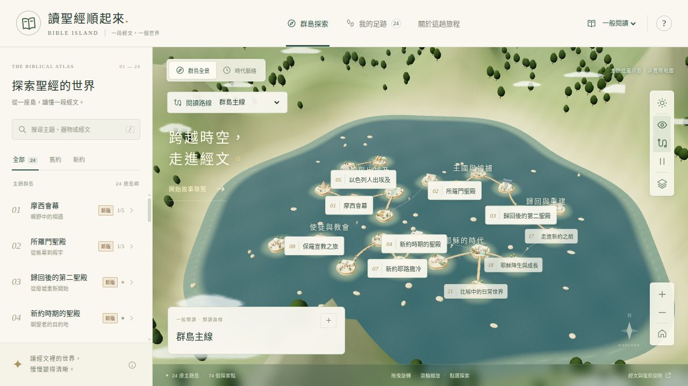

# 讀聖經順起來：本次交付

2026-11-17。正式網站：[Bible Island](https://bible-island.starryswift8.chatgpt.site)。延用既有Sites專案與擁有者私人分享範圍；第41版已成功發布，執行期來源`62e60b09e9ade7d36fd2bcc845da6692045e7090`，Sites來源`786e7663cc052e35c64d94b2999969f2f59e0032`。精確版本、封裝雜湊與部署時間見[部署紀錄](DEPLOYMENTS.md)。後補文件不表示另有一個應用版本。

最後交付分頁已實讀入口index-DwC2hrCZ.js，一般閱讀、動畫開啟；上圖為正式網站1280×720實際截圖。暫存素材驗證分頁已關閉，使用者原分頁保留；沒有為截圖更動viewport或重啟伺服器。

## 已交付範圍

- 群山、樹林與22組移動白雲環繞中央水域；橋、閱讀航線與關係卡連接24座主題島。這是閱讀關係圖，不是聖經時代的真實群島或道路圖。
- 原五座重點島及其後十九島全部接入詳細場景。逐島有公尺尺度、公共步行路線、人物與器物觀察、情境對話及閱讀流程；地方、年代與敘事時刻分開，避免拼成同一天的場景。
- Blender 4.5.16 LTS原創可編輯來源包含101個非空素材場景，匯出101GLB：28種人物、71件觀察物及2種羊。保存製作腳本、幾何報告與素材取捨；近處骨架、距離步態、足部接地及指定教具拆還已接入Three.js。
- NPC使用各自seed、速度與狀態計時、加權POI及容量預約，結合分離、預測避讓與平滑轉向。合格相遇獨立抽20%短談3–6秒；工作與渡海隊伍另受角色及敘事限制。沒有全體共用決策時鐘或Random Walk。
- 第一人稱WASD／方向鍵、拖曳環顧、點地尋路、觸控入口及近距離E互動。控制器保留0.35m跨階、45度坡限、地面吸附、樓梯代理及視覺Y平滑；慢幀按有界小步積分，修正微小餘步誤取消路線。
- 72位對話角色、576個一般／親子cue及75份本機MP3，配合字幕、選用導讀朗讀、環境音、腳步與現代原創音樂。章節、時刻及模式切換取消舊聲，聲音由使用者啟動。
- 全24島提供一般閱讀、親子探索及深入研讀。觀察、提示、核對來源、分類及完成閱讀有不同條件，各島各模式分開保存；器物觀察不充當讀經完成。經文外連統一YouVersion 312 CSBT。

## 驗證與證據

最終完整來源回歸51檔320項通過（201.35秒），內容24島／74探索點、語法與diff檢查通過。正式建置137模組、1.53秒；自包含離線試閱220323KiB。未為文件變更重跑相同測試或重複發布。原始日誌及離線頁保留於忽略的`.qa/`。

逐島研究、素材、配音來源、實際瀏覽器操作與失敗後修正均記在[工作表](BLENDER-AND-REMAINING-ISLANDS.md)所連的驗收文件。自動測試、Blender渲染、實際UI操作與真人審查分開記錄；瀏覽器逾時不直接算作操作成功，沒有因此重啟開發伺服器或重複生成配音。

第24島的本機及正式三件近景、三模式與播放／取消已完成實際操作；原文件盤點的七個早期特定缺口亦全部補驗：希律石材／院界／柱式、出埃及渡海剖面、大衛cart／pause／carry。指定拆還、時刻互斥、合法沿路接近及返回閱讀分別記錄；沒有把僅啟動路線當作到達。結束時人物動畫恢復，沒有交談、近景或自動行走，正式warning／error=[]。

## 使用與驗證界線

模型為原創教學復原，含風格化選擇；不是考古掃描、原物認證或已確認的古代服裝全貌。經文、研究及復原推定分層，人物台詞不冒充史料原話，不強指定出埃及年代、法老或路線。

完整真人逐句聽驗、獨立聖經歷史專家簽核及實體手機／多裝置效能尚未取得。瀏覽器模擬尺寸與回歸不替代這些驗證。既有Three.js大chunk建置提醒保留，未宣稱固定FPS。

足跡、收藏、各模式進度與札記只存目前瀏覽器，無跨裝置同步或AI自由對話。Sites分享範圍未擴張；原始碼推送與GitHub Pages上線是不同工作。
