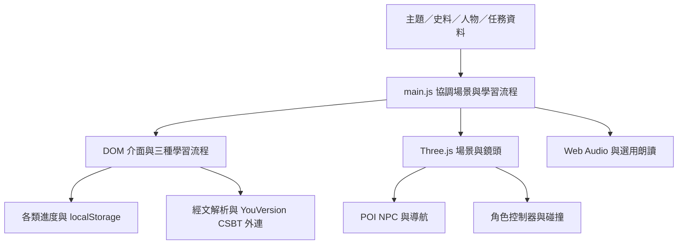

# 讀聖經順起來：實作原則與技術總整理

整理日期：2026-11-15。以目前本機原始碼與各輪試閱紀錄為準；本文件整理已討論的開發原則，並區分已實作、局部示範與後續規劃。網站部署狀態需另外確認，不能由本機功能推定 Sites 已同步更新。

2026-11-16 接續擴充：歸回後第二聖殿接入第七座詳細島，以分章切換奠基、復工與守節；新增四種人物、三件 Blender 教具及三位角色／24 段配音。現在共 39 份 GLB、21 位可交談角色／168 段錄音，其他十七島待製作。見 [建殿驗收](review/RETURN-TEMPLE.md)。

2026-11-16 擴充：過約旦河已接入第六座詳細場景，新增三位角色／24 段配音、三件 Blender 教具、兩岸居民與單向隊伍；全專案共 32 份 GLB、18 位可交談角色／144 段錄音。當前證據見 [約旦河驗收](review/JORDAN-WALK.md)。下文五島表及測試數保留當時整合里程碑，其他十八島仍待逐島製作。

後續進度：群島全景與五座重點島已依 [套用計畫](FOCUS-ISLAND-ROLLOUT.md) 完成本機整合。各島的入口、實測證據與限制集中在 [五島總驗收](review/FIVE-ISLAND-ACCEPTANCE.md)；各階段舊測試數是當時里程碑。

## 1. 產品目標與開發順序

讓兒童到成人透過建築、器物、地形與古代日常，理解經文中的處境，再回到經文本身。基本體驗為：**觀察場景 → 提出問題 → 互動或對話 → 閱讀經文 → 連結其他主題**。

- 每座 island 代表一個有閱讀目標的主題；島嶼之間表達故事接續、同地異時、地理相鄰、空間或主題比較、人物與書信等關係。群島配置是閱讀導覽，不能直接當作古代真實地圖。
- 遊戲互動必須幫助觀察與理解；看見熱點、開啟資料、答對問題及完成閱讀是不同事件，不能混算進度。
- 所有年齡共用相同的歷史準確度與模型品質。模式調整引導方式、操作與資料深度；親子模式同樣需要交代復原限制。
- 先優化五座重點島，經使用者檢視後再擴大套用。共用技術可重用，各島的空間、人物職分、活動與台詞仍需個別設計。

五座重點島為 **摩西會幕 `tabernacle`、所羅門聖殿 `solomon`、新約時期／希律擴建後第二聖殿 `herod`、以色列人出埃及 `exodus`、新約耶路撒冷 `jerusalem`**。歸回後的第二聖殿初期 `second-temple`、過約旦河及保羅宣教之旅，尚未列入這批詳細升級。

## 2. 現況與適用範圍

| 功能 | 已實作範圍 | 邊界 |
| --- | --- | --- |
| 主題群島、搜尋、關係、經文、收藏與足跡 | 24 座主題、74 個探索點 | 部分島嶼仍採原版程序模型 |
| 公尺尺度詳細場景、全景／人物尺度／俯視、室內剖面與復原說明 | 五座重點島 | 程序建模，尚非考古測繪或電影級擬真 |
| 動態人物、選項式情境對話 | 五座重點島，每島 3 位可交談角色，共 15 位 | 原有 45 個主題問答及 15 個延伸追問；親子引導另有適配內容 |
| 親子任務、一般故事導覽、研讀工作台 | 五座重點島 | 其他 19 島保留三種文字導讀，明示完整流程適用範圍 |
| 自由步行、點地尋路、器物近景互動 | 五座重點島；出埃及分為三個獨立章節 | 第一人稱、有界探索區；共 14 件觀察物，尚無第三人稱主角或全城漫遊 |
| POI 自主行為、動態避讓、居民短暫交談 | 五座重點島 | 人數與容量依場景設定，見總驗收表；工作與行軍不套用閒逛短聊，渡海使用單向 POI 與畫外人物池 |
| 跨矮階、坡度限制、下行吸附與視覺平滑 | 五島共用步行控制器 | 沒有跳躍或大落差墜落玩法 |
| 空間環境音、腳步、人物配音與選用配樂 | 五座重點島 | 每島 24 段原版／親子配音；耶路撒冷保留原 15 段並另加 9 段親子錄音；音樂明示現代原創 |
| 導讀與親子提示朗讀 | 五座重點島的對應介面 | 導讀使用選按的瀏覽器中文語音；五島親子對話使用對應錄音 |
| AI 自由對話、全島自主 NPC、雲端同步 | 後續規劃 | 尚未實作 |

## 3. 聖經歷史與復原原則

以可核對的資料與明確的不確定性，回應「更嚴苛的聖經歷史專家標準」。目前仍是開發試閱，**尚未經聖經歷史學者獨立審稿**。

### 證據分層

場景與說明區分 **經文描述、考古參考、示意復原、經文詮釋**。每座詳細場景保存事實依據、復原限制及來源；沒有證據支持的外形、間距、人口、價格或座標，不能包裝成確定史實。

研讀練習則讓使用者把主張分類為「經文描述／歷史研究／復原推定」。這是學習操作分類，與場景的四類證據標籤用途不同；開啟一個來源也不代表來源支持所有主張。

### 尺度與時代

- 詳細場景使用公尺；成人模型參照身高 1.70 m、頭部約 0.225 m，兒童依身高縮放，不使用大頭娃娃比例。這是建模基準，並非宣稱所有古代成人皆為此身高。
- 古代「肘」暫以 0.45 m 統一換算，必須標明這是建模約定，不是各時代皆有定論的肘長。
- 會幕、第一聖殿、歸回後第二聖殿及希律擴建階段須分清。希律擴建後仍屬第二聖殿，不能把會幕約櫃移植到新約聖殿；會幕洗濯盆也不能與所羅門銅海混用。
- 約瑟夫斯、《米示拿》與考古資料有各自年代和適用範圍，不直接拼成某一年的確定全貌。西元 66 年城市模型不能直接等同耶穌活動年代。
- 出埃及不強行指定單一法老、日期、路線或渡海位置。製磚、逾越節及渡海是分段敘事並置，不能看成同時發生、彼此相鄰的地理。
- 耶路撒冷街區採第一世紀生活類型復原；上城富裕住居不代表所有家庭。不能將迦百農拆屋頂的事件改放到耶路撒冷，也不能加入後世建築。

具體來源、各島取捨及人物脈絡見 [五座歷史場景說明](review/HISTORICAL-FIVE.md)，持續開發時須維護逐項來源。

## 4. 視覺與場景刻畫

目標是比例可信、空間可讀、成人也願意探索的歷史教學場景。現階段以程序化幾何逐步改善，寫實程度仍須實際檢視。

- **真實比例：** 人物、門窗、階梯、器皿與建築共用尺度，先檢查人物站在物件旁是否合理，再增加細節。
- **多層構圖：** 前景提供可觀察器物與人物，中景呈現主要活動與建築，遠景交代地形、城市輪廓、營地或相關空間；擴大視野也要保留主題焦點。
- **生活脈絡：** 以院落、巷弄、工藝、織物、行囊、器皿及合理活動豐富場景；避免只靠增加重複物件填滿畫面。
- **空間理解：** 全景理解關係，人物尺度感受大小，俯視理解配置；探索室內器物時開啟剖面。剖面是教學視圖，不是建築真實缺口。
- **介面可讀：** 中文文字、字幕、來源與操作入口保持清楚；模式差異同時透過文字、圖示與行動呈現，不只更換顏色。

## 5. 技術架構與資料流

目前採 **原生 JavaScript ES Modules + Three.js 0.180.0 + Vite 6.4.6**，以 DOM／CSS 製作閱讀與操作介面。使用自有運動學控制器，沒有引入 Unity、Godot 或剛體物理引擎。模型與素材由本專案製作，不能據此推定參考網站的內部技術。



| 責任 | 主要檔案／技術 |
| --- | --- |
| 主題、探索點、關聯與史料 | `src/content.js`、`src/historical-data.js` |
| 群島、時代、閱讀連結與連續海面 | `src/atlas-data.js`、`src/atlas-network.js`、`src/atlas-environment.js`、`src/atlas-ui.js` |
| 出埃及章節與單向隊伍 | `src/exodus-exploration.js`、`src/exodus-scenes.js`、`src/exodus-ui.js`、`src/convoy-system.js` |
| 3D 場景、鏡頭、點選與詳細模型 | `src/world.js`、`src/historical-scenes.js`；PerspectiveCamera、OrbitControls、Raycaster |
| 人物資料、指定路線、動作與對話介面 | `src/people-data.js`、`src/people-motion.js`、`src/people-ui.js` |
| POI 與自主代理 | `src/npc-pois.js`、`src/npc-system.js` |
| 街區地面、導航、輸入與步行任務 | `src/walk-data.js`、`src/walk-model.js`、`src/walk-controls.js`、`src/walk-ui.js` |
| 接地與視覺高度 | `src/character-controller.js` |
| 聲音、配音索引、器物與選用朗讀 | `src/scene-audio.js`、`src/voice-manifest.json`、`src/vessels.js`、`src/reading-speech.js` |
| 學習內容、完成條件與介面 | `src/learning-data.js`、`src/learning-model.js`、`src/learning-ui.js` |
| 經文解析與共用連結介面 | `src/scripture.js`、`src/scripture-ui.js` |
| 入口協調與原有足跡 | `src/main.js`、`src/progress.js` |

內容、狀態轉換及顯示分開：同一個完成條件由狀態模型判斷，介面依狀態更新；不可只把按鈕變色當作完成。3D 點選與側欄入口共用內容參照，提供鍵盤及 WebGL 失敗時的閱讀途徑。

## 6. 自然 NPC：不可退回共用計時或 Random Walk

目前已在耶路撒冷、會幕及所羅門實作；會幕與所羅門加入職分區域與可設定出生點。其他島套用前須重新設計各自的可行走範圍、角色活動及 POI。

1. **POI 目標驅動：** 節點含互動類型、權重、容量、明確站位、面向、停留區間與角色標籤。從有空位、角色可用且不同於上一站的 POI 加權選擇，考慮距離、偏好與造訪次數，再用 A* 找路。出發即預約站位，取消、離開或換狀態時釋出。
2. **個體狀態：** 每人有由唯一身分衍生的 seed、自己的 PRNG、狀態、目標、停留時間、冷卻與動作相位。抵達後執行 `Idle`、`LookAround` 或 `Interact`，停留後再決策。共用每幀 `dt` 只供積分，不作全體切換行為的計時器。
3. **速度與時間錯開：** 基礎速度 0.8 m/s × 0.85–1.15；動畫同步調整。初始決策時間約分散在 0.4–4.9 秒，各人的後續計時也獨立，避免同幀整群起停。
4. **分離與避讓：** 導航向量結合約 1.84 m 範圍分離力、預測相遇的側向避讓及個體偏好。另以分段圓形碰撞約束，防止 NPC 與玩家穿透；成人 NPC 半徑 0.29 m，玩家 0.32 m，保留間隙。狹路允許停讓，不把「自然」誤解為完全不會排隊。
5. **平滑轉身：** 朝向沿最短角度作指數插值，限制最大角速度 2.2 rad/s，避免瞬間 90°／180° 轉向；步態依實際移動速度更新。
6. **偶發交談：** 各人獨立檢查；雙方閒逛、無牆阻隔、距離小於 1.65 m 且冷卻結束時，一次合格相遇抽一次 20%。成功則停步、面向彼此、顯示氣泡與手勢 3–6 秒，再各自恢復行程；失敗也進入冷卻，不能每幀重抽。
7. **玩家優先：** 玩家開啟對話會中斷短暫社交，指定角色停步回應；關閉後恢復。僅站在附近只短暫引起注意，不讓角色永遠停住。

指定路線仍適用於有敘事限制的活動，例如出埃及隊伍只能向前到終點停留，不能為了套用自主系統而折返或任意離隊。詳細設計與模擬驗證見 [NPC 自主行為](review/NPC-BEHAVIOR.md)。

## 7. 主角移動：接地、樓梯與鏡頭分離

會幕、所羅門與耶路撒冷採第一人稱控制：WASD／方向鍵、拖曳環顧、選用指標鎖定、觸控按鈕與可被手動操作中斷的點地尋路。互動需要距離與視線條件；失去焦點清除按鍵，對話及視窗暫停移動。

導航使用 0.4 m 網格 A* 與空間索引；移動拆成最長 0.08 m 的小段，檢查地面、障礙、牆面滑動與頭頂空間。路徑邊也用實際移動規則檢查，避免導航認為可走、角色卻卡住。

| 機制 | 參數與實作要求 |
| --- | --- |
| Step Offset | `maxStepHeight = 0.35 m`；可站立頂面、抬升路徑與頭頂空間均通過後才跨越 |
| Slope Limit | `maxSlopeAngle = 45°`；由地面法線判定，不能靠連續小步繞過坡度限制 |
| Ground Snap | `groundSnapDistance = 0.45 m`、`groundSnapSpeed = 3 m/s`；接地下行時約束到安全地面，大落差停在邊緣 |
| Collision Proxy | 樓梯可見幾何保留逐級石材，物理使用明確坡面代理；實際踢面高度仍受跨階上限約束 |
| Y 平滑 | 物理腳底 `position` 與 `visualPosition` 分開；相機使用視覺高度 + 1.65 m。上行平滑時間 0.08 s，下行 0.055 s，採不超調的臨界阻尼 |
| 速度與動畫狀態 | 上行速度約 0.8 倍；提供 `isGrounded`、`groundNormal`、`isClimbingStairs`、`verticalDirection` 及 `stairs-up`／`stairs-down` 狀態 |

碰撞與 NPC 避讓使用物理位置，鏡頭使用平滑位置；停步及對話時仍持續收斂，避免卡階、鏡頭抖動或下樓長時間漂浮。這是運動學接地約束，不是剛體向下施力；尚未加入第三人稱上下階骨架動畫。詳見 [角色控制器](review/CHARACTER-CONTROLLER.md)。

## 8. 對話、聲音與沉浸感

- **情境對話先寫作再實作：** 依角色職分、時代、當下物件與經文脈絡設計選項、回答及追問。綜合設計的 NPC 不冒充可考證的歷史人物，台詞不冒充經文引言或逐字史料。
- **聲音由使用者啟動：** Web Audio 管理環境與語音音量；HRTF 空間定位隨聽者位置、方向變化，說話時降低環境音，離開場景、關閉對話或頁面隱藏時停止語音。所有任務保留字幕與安靜探索。
- **環境音與音樂分開：** 現有風、鳥鳴、布棚與腳步採程序合成。會幕整合輪已加入可獨立關閉的現代原創程序配樂，並共用到五島；出埃及依章節切換工作、住家及風水聲，換章取消舊短音效。聲景不宣稱是古代原音復原。
- **兩種語音來源分清：** 五島十五位角色共 120 段對應錄音、18 份本機 MP3；耶路撒冷的三份原音與十五段時間碼保留，另有三份親子 MP3。音訊依實際來源 URL 採最多四份解碼快取；導讀使用選按的瀏覽器 SpeechSynthesis。錄音只播放與目前台詞一致的區間。
- **可用性與來源透明：** 瀏覽器沒有中文聲音時提供文字回饋。既有配音來自 zh-CN 聲音目錄，不聲稱臺灣口音或古代語言；人名、地名與完整語氣仍待真人審聽。

目前沒有 AI 自由對話、嘴形同步、室內混響或執行時遠端語音生成。操作與製作來源見 [耶路撒冷步行與聲音](review/JERUSALEM-WALK.md)及[配音紀錄](review/JERUSALEM-VOICE-PROVENANCE.json)。

## 9. 經文連結與三種學習模式

### YouVersion CSBT

所有聖經經文連結統一使用 **YouVersion、繁體中文介面、CSBT 版本 312**；書卷、章節與原參照內容必須保留。標準格式為：

```text
https://www.bible.com/zh-TW/bible/312/{USFM}.{章}[.{節或節範圍}].CSBT
例：https://www.bible.com/zh-TW/bible/312/JHN.1.CSBT
```

經文解析集中處理 66 卷書的代碼、章數、別名與複合參照。跨章、跨書卷及不連續段落拆成獨立連結，不能拼出無效網址或只保留第一段。跨章開頭以整章入口加文字說明起始節，不假裝已精準選取整個跨章範圍。研究、考古與博物館資料保留各自來源，不改成經文網址。

站內摘要自行撰寫，完整經文由讀者開啟外站閱讀；目前沒有內建整部聖經全文或取得全文重製授權的宣稱。

### 模式必須改變行動與完成條件

| 模式 | 使用者實際做什麼 | 完成與回饋 |
| --- | --- | --- |
| 親子探索 | 每島三個觀察任務；先「前往觀察」，再作答，可找人物提示及追問 | 未觀察不開放作答；錯答給提示並可重試，答對才完成，附經文脈絡與復原限制 |
| 一般閱讀 | 依故事起點、逐幕觀察、導讀、提問與 CSBT 連結閱讀到結尾 | 觀看後明確按「讀完」才記錄並前往下一幕；這是讀者自我確認，無法驗證外站實際閱讀 |
| 深入研讀 | 每島三項主張；先開啟依據與限制再分類，搭配俯視／人物尺度、相關場景比較及札記 | 開資料本身不算完成；符合前置條件且分類正確才完成，旁註明示「非角色發言」 |

切換模式須立即呈現不同的第一個行動，並結束原有交談／行走，保留各模式進度。耶路撒冷一般模式沿用四階段步行小旅程；親子與研讀自由行走提供返回任務／工作台入口，不被不相容的舊對話條件卡住。詳見 [學習流程與驗證](review/LEARNING-MODES.md)。

## 10. 效能、可及性與本機資料

- 共享幾何與材質，以 `InstancedMesh` 批次繪製；靜態建築與動態人物分開。人物透過關節變換更新實例矩陣，尚無匯入骨架、動作捕捉或真人掃描素材流程。
- 建築陰影按需更新，動態人物使用柔邊接觸陰影；限制像素比例，持續慢幀時降低解析度。隱藏頁面停止模擬，遵循 `prefers-reduced-motion`。這些措施不等於已保證所有裝置達到固定 FPS。
- 保留字幕、鍵盤入口、焦點回饋與窄螢幕布局；WebGL 失敗仍可閱讀文字內容，不讓聲音成為完成任務的必要條件。
- `bible-island:progress:v1` 保存原有足跡與收藏；`bible-island:jerusalem-walk:v1` 保存步行旅程；`bible-island:learning-modes:v1` 保存模式偏好、各島各模式的學習狀態及札記。三者不混算。
- 札記以純文字處理、顯示時跳脫並限制長度；儲存不可用時仍可閱讀。資料只在目前瀏覽器，沒有登入、後端、跨裝置同步或流量追蹤；清除瀏覽器資料會影響保存內容。
- `#island=...` 可分享主題位置，不分享個人進度。

## 11. 驗收與交付原則

### 每次功能變更依風險驗證

| 項目 | 應確認內容 |
| --- | --- |
| 歷史與內容 | 來源可查、年代分清、復原限制可見、經文參照未遺失；專家審稿另行安排 |
| 模型與畫面 | 比例、層次、視野、剖面、熱點位置、幾何與實例變換有效 |
| NPC | seed 可重現、計時獨立、容量不超額、路線有效、人物不穿透、轉向平滑、交談機率與冷卻符合規範 |
| 主角移動 | 合法／超高台階、頭頂限制、坡度界線、上下階持續接地、30／60／144 FPS 平滑及對話停步 |
| 學習流程 | 觀察與來源前置條件、錯答提示、完成判定、各島各模式進度隔離、返回流程及重新載入 |
| 音訊與裝置 | 配音對應台詞、取消與音量、無中文語音回饋、桌機／觸控／鍵盤；真人審聽與各型手機仍需補足 |

目前五島整合回歸為 **93 項測試**，另做 24 島／74 探索點的內容檢查、正式建置、自包含試閱與瀏覽器操作。各輪文件中的 21／29／37／59／65／77／87 項是當時里程碑。最新結果與可重現入口見總驗收表。學習模式輪的瀏覽器沒有中文語音，不能聲稱已在該環境聽驗瀏覽器朗讀；本機錄音也仍待完整真人審聽。

一般功能變更使用 `npm run check`、`npm test`、`npm run build`，再針對實際改動做瀏覽器驗收。避免把模擬測試、單一裝置試玩或來源存在，寫成全面品質認證。

### 開發、試閱與發佈分開

- `npm run dev` 開啟本機開發；`npm run build` 產生 `dist/`，Vite 使用相對資源路徑；`npm run preview` 檢視建置結果。
- `npm run review:bundle` 以 esbuild 打包單一 HTML，內含程式、樣式與配音資源並保留授權資訊；外部經文及研究連結仍需網路。既有試閱曾以 HTTP 驗證，未直接驗證所有瀏覽器的 `file://` 開啟流程。
- GitHub 原始碼、單檔試閱與 Sites 是不同交付物。推送、建置成功及本機瀏覽正常，都不代表 Sites 已更新；正式發佈須另外執行並確認實際網址與存取權限。

## 12. 後續擴充的順序與限制

五座重點島的具體順序、各島互動、共用模組與交付關卡，見 [依序套用實作計畫](FOCUS-ISLAND-ROLLOUT.md)；該文件記錄已完成的本機整合順序；正式發佈、獨立歷史審稿及實體裝置驗收分開記錄。

下一座島應沿用以下流程：**確認閱讀目標與年代 → 蒐集並分層史料 → 建立公尺尺度與多層場景 → 設計合法動線及角色 POI → 撰寫有來源的對話 → 補齊三種學習流程與 CSBT 連結 → 驗證、試玩與使用者檢視 → 決定是否擴展及發佈**。

尚待規劃或完成的項目包括：

- 經使用者檢視這批五島後，再逐島擴展；早期第二聖殿、過約旦河及保羅分次宣教路線另行建模。
- 更細緻的材質、人物與動作；第三人稱角色、骨架上下階動畫、嘴形同步及室內聲學。
- 擴充各島的現代原創背景音樂與情境配音，以及真人完整審聽。
- 聖經歷史專家獨立審稿、逐物件來源、真實裝置效能與可及性檢查。
- 若加入生成式自由對話，另設史料範圍、引用、時代角色界線及無依據時的回應方式；目前的選項式對話不能視為已具備這些能力。
- 帳號、雲端進度、教師課程與多人互動屬另外的產品與資料架構工作。

本文件是後續決策與驗收的共同依據；功能範圍改變時同步更新此處，詳細實作與階段證據繼續保留在 `docs/review/`。


2026-11-16 接續保羅旅程為第八座詳細島：共用分章狀態按不同城市／行程切換，選取帕弗、腓立比、以弗所代表片段，不把全地中海縮成同一條步道。附各次路線摘要及押解赴羅馬獨立入口；資料與城市分期見 [保羅旅程驗收](review/PAUL-JOURNEYS.md)。歷史敘述與既有五島表格保留其原有階段時間，最新適用範圍為八島，其他十六島繼續。

2026-11-16 亞伯拉罕接入第九座詳細島：保留 altar／tent／well 原探索點 ID，改按創 12、18、21 章排序並分開場景時刻。每章 13 位自主人物、8 組 POI／16 個容量位置；三種人物、三件器物與一種羊在 Blender 實際製作，七隻羊的頭尾節點各自微動。區分經文中的接待分工與井水協議，禁止把後期四角壇、現存深井或比較陶器當作列祖身分／年代證據。全站共 52 份 GLB、30 份 MP3、27 位可交談角色／216 段 cue；其餘十五島與未完成的人工驗證繼續，見 [亞伯拉罕驗收](review/ABRAHAM-JOURNEY.md)。


2026-11-16 約瑟接入第十座詳細島：保留 caravan／grain／family，按創 37、41、45 排序。山路、倉院與家屋為不同時刻，不把相認與雅各遷居放在同一幕。三章各 13 人、8 組 POI／16 個位置；新增三種獨立人物、三件原創功能比較教具和 24 段配音。全站 58 份 GLB、33 份 MP3、30 位可交談角色／240 段 cue；完整回歸 171／171。埃及模型的喪葬用途及年代不拿來定位約瑟的法老；供糧與失地／失自由的張力都有導讀。其餘十四島與人工驗證繼續，見 [約瑟驗收](review/JOSEPH-EGYPT.md)。
